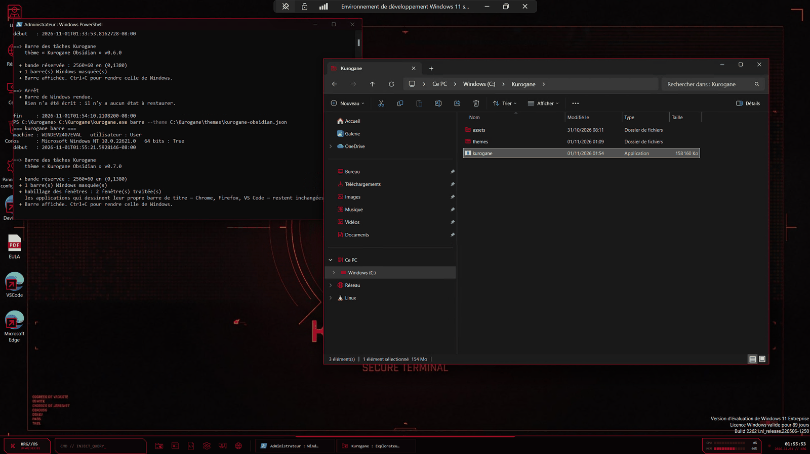
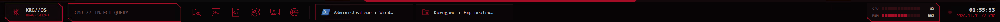

# Kurogane

Personnalisation visuelle de Windows 11, entièrement réversible.

Kurogane applique un thème décrit dans un fichier JSON — mode sombre, couleur
d'accent, fond d'écran, icônes du shell, barre des tâches et menu Démarrer.

**L'application d'un thème ne touche à aucun fichier système** : uniquement des
clés de registre et des `desktop.ini`. Une commande distincte, qui n'est
appelée par aucun module de thème et exige une double autorisation explicite,
peut remplacer des icônes à l'intérieur d'un binaire du shell — voir *Niveau 3*
plus bas.

> `Kurogane` (黒鉄, « fer noir ») est un nom de travail. Le thème livré,
> *Obsidian*, est une création originale : il ne reprend ni le nom, ni le logo,
> ni les éléments graphiques d'une œuvre existante.

## Aperçu



La barre Kurogane, en détail :



De gauche à droite : le module système, la console de lancement, les
épinglés du thème, les fenêtres ouvertes, les jauges processeur et mémoire,
l'horloge.

## Le principe

**La simulation est le mode par défaut.** Sans `--commit`, rien n'est jamais
écrit — l'outil lit l'état actuel, affiche exactement ce qu'il changerait, et
s'arrête là.

Trois garanties, dans cet ordre :

1. **Lire avant d'écrire.** Chaque modification capture la valeur d'origine,
   y compris le cas « la valeur n'existait pas » — qui se restaure par une
   suppression, pas par l'écriture d'un zéro.
2. **Point de restauration write-ahead.** L'état d'origine complet est écrit
   sur disque *avant* la première modification. Une coupure en cours de route
   laisse donc un point de restauration exploitable.
3. **Retour arrière automatique.** Si une écriture échoue, les précédentes sont
   défaites dans l'ordre inverse avant que l'outil ne rende la main.

## Compiler

Visual Studio 2022 (17.8+) ou le SDK .NET 8 en ligne de commande :

```
dotnet build src/Kurogane/Kurogane.csproj -c Release
```

Cible : `net8.0-windows`, x64. Aucun paquet NuGet.

## Utiliser

```
# Voir ce qui serait modifié — n'écrit rien
kurogane apply --theme themes\kurogane-obsidian.json

# Appliquer
kurogane apply --theme themes\kurogane-obsidian.json --commit

# Lister les points de restauration
kurogane list

# Revenir en arrière (simulation, puis réel)
kurogane restore --last
kurogane restore --last --commit

# Forcer le shell à relire les icônes
kurogane refresh-icons            # notification + ie4uinit
kurogane refresh-icons --purge    # purge du cache, redémarre explorer
```

Remplacer la barre des tâches et habiller les fenêtres, à chaud :

```
kurogane barre --theme themes\kurogane-obsidian.json
kurogane probe-chrome --theme themes\kurogane-obsidian.json
```

Restylage de la barre des tâches, à chaud et sans rien écrire :

```
kurogane taskbar-style --marge 12 --marge-basse 6 --rayon 10 --teinte "#C8102E"
kurogane taskbar-style --reinitialiser
```

Substitution d'icônes dans un binaire du shell — voir *Niveau 3* plus bas :

```
kurogane substituer-mun --theme themes\kurogane-obsidian.json
kurogane substituer-mun --theme themes\kurogane-obsidian.json --commit --autoriser-fichier-systeme
kurogane restaurer-mun --commit
kurogane etat-mun
```

Diagnostics, tous en lecture seule sauf `probe-icons` :

```
kurogane probe-taskbar              # inventaire des réglages de la barre
kurogane probe-taskbar-fenetres     # hiérarchie des fenêtres de la barre
kurogane probe-mun [--binaire <nom>]  # catalogue des icônes d'un binaire
kurogane probe-mun-ecriture         # valide le graveur de ressources sur copie
kurogane probe-icons [--commit]     # écrit une icône témoin dans les cibles candidates
```

Un `.ico` remplacé sans changer de nom ne produit aucune modification de
registre : le registre stocke un chemin, pas un contenu. C'est le rôle de
`refresh-icons --purge`, le cache d'icônes survivant à un redémarrage
d'explorer.

Points de restauration : `%LOCALAPPDATA%\Kurogane\snapshots\`
Journaux : `%LOCALAPPDATA%\Kurogane\logs\`

Les modules de niveau 1 (mode sombre, accent, fond d'écran, icônes du Bureau,
dossiers du profil) n'exigent aucune élévation. Les icônes génériques — dossier,
lecteur, flèche de raccourci — écrivent dans `HKEY_LOCAL_MACHINE` et demandent
une invite administrateur. Sans élévation, l'outil l'annonce avant de poser le
point de restauration et n'écrit rien : la permission est vérifiée clé par clé,
l'élévation ne la garantissant pas.

## Le fichier de thème

```json
{
  "name": "Kurogane Obsidian",
  "version": "0.3.1",

  "darkMode":  { "apps": true, "system": true },

  "accent": {
    "color": "#C8102E",
    "titleBars": true,
    "taskbarAndStart": true,
    "transparency": false
  },

  "wallpaper": {
    "path": "../assets/wallpapers/Wallpaper_Kurogane.jpg",
    "style": "fill"
  },

  "taskbar": {
    "alignment": "left",
    "size": "small",
    "search": "icon",
    "combineButtons": "always",
    "secondsInClock": true
  },

  "startMenu": {
    "layout": "morePins",
    "recentFiles": false
  },

  "icons": {
    "directory": "../assets/icons",
    "cePc": "ce-pc.ico",
    "corbeilleVide": "corbeille-vide.ico",
    "corbeillePleine": "corbeille-pleine.ico",
    "dossier": "dossier.ico",
    "lecteur": "lecteur.ico",
    "raccourciFleche": "raccourci-fleche.ico"
  }
}
```

La section `icons` accepte quinze entrées ; l'exemple n'en montre que six.

Quatre sections supplémentaires, facultatives, n'interviennent pas dans
`apply` : elles décrivent des effets posés à chaud, qui n'écrivent rien.

| Section        | Lue par                   | Contenu                                           |
| -------------- | ------------------------- | ------------------------------------------------- |
| `taskbarStyle` | `taskbar-style`, `resident` | marges, rayon, teinte et opacité de la barre Windows |
| `barre`        | `barre`                   | nœud, état, suffixe de date et épingles de la barre Kurogane |
| `fenetres`     | `barre`, `probe-chrome`   | `coinsCarres`, `barreTitre`, `texteTitre`, `bordure` |

```json
"fenetres": {
  "coinsCarres": true,
  "barreTitre": "#120A0C",
  "texteTitre": "#E8DFE1",
  "bordure": "#C8102E"
}
```
Chaque entrée est facultative et une icône absente laisse celle de Windows en
place.

Toute section absente est simplement ignorée : un thème qui ne déclare que
`accent` ne touchera pas au fond d'écran. Les chemins relatifs sont résolus
depuis le dossier du fichier de thème.

Ajustements acceptés pour le fond d'écran : `fill`, `fit`, `stretch`,
`center`, `tile`, `span`.

## Architecture

```
src/Kurogane/
├── Core/
│   ├── ChangeRecord.cs      Trace sérialisable d'une modification, et son inverse
│   ├── RegistryChange.cs    Écriture de registre : capture, contrôle d'accès, inverse
│   ├── FileChange.cs        Écriture de fichier : contenu, attributs, fusion desktop.ini
│   ├── OwnershipChange.cs   Prise de possession d'une clé protégée (voir plus bas)
│   ├── FileOwnership.cs     Prise de possession d'un fichier et de son dossier
│   ├── Privileges.cs        SeTakeOwnership / SeRestore
│   ├── PeResources.cs       Arbre de ressources d'un PE, remplacement sur place
│   ├── MunPatcher.cs        Plan de substitution d'un groupe d'icônes
│   ├── SourceIco.cs         Images d'un .ico à la taille demandée
│   ├── IcoReader.cs         Lecture de .ico, décodage des bitmaps 32 bits
│   ├── Shell.cs             Redémarrage de l'Explorateur
│   ├── PngWriter.cs         Encodeur PNG sans dépendance (ZLibStream)
│   ├── Snapshot.cs          Point de restauration (write-ahead, écriture atomique)
│   ├── Journal.cs           Journal console + fichier
│   ├── IconCache.cs         Rafraîchissement et purge du cache d'icônes
│   ├── IcoWriter.cs         Écriture de .ico multi-résolution, sans dépendance
│   ├── Elevation.cs         Droit d'écriture effectif dans HKLM
│   └── ColorUtil.cs         Conversions ABGR / ARGB, nuancier d'accent
├── Modules/
│   ├── IThemeModule.cs      Plan() sans effet de bord, PostApply() notifie
│   ├── DarkModeModule.cs
│   ├── AccentModule.cs
│   ├── WallpaperModule.cs
│   ├── DesktopIconsModule.cs    Icônes du Bureau            (HKCU)
│   ├── SpecialFoldersModule.cs  Dossiers du profil          (desktop.ini)
│   ├── ShellIconsModule.cs      Dossier, lecteur, raccourci (HKLM)
│   └── TaskbarModule.cs         Barre des tâches, menu Démarrer (HKCU)
├── Probe/
│   ├── IconProbe.cs         Diagnostic : quelles cibles répondent
│   ├── OwnershipProbe.cs    Diagnostic : clés protégées
│   ├── TaskbarProbe.cs      Inventaire de la barre des tâches (lecture seule)
│   ├── MunProbe.cs          Catalogue des icônes système (lecture seule)
│   ├── MunWriteProbe.cs     Validation du graveur sur copie, contrôle d'intégrité
│   └── MunSubstitution.cs   Substitution réelle, sauvegarde et garde-fou
├── Native/
│   ├── NativeMethods.cs     SystemParametersInfo, WM_SETTINGCHANGE, SHChangeNotify
│   └── ResourceNative.cs    Lecture des ressources d'un module, en données seules
├── Theme/
│   └── ThemeDefinition.cs   Modèle du fichier JSON
└── Program.cs               CLI
```

Pour ajouter un module : implémenter `IThemeModule` et l'inscrire dans le
tableau `Modules` de `Program.cs`. Le contrat est strict — `Plan()` ne doit
avoir aucun effet de bord. Tout ce qui écrit passe par les objets `IChange`
retournés, donc par la capture et le point de restauration. Deux natures de
modification cohabitent, registre et fichier, sous le même contrat.

## Portée

Ce que l'outil fait, et ce qu'il ne fera pas :

| | |
|---|---|
| **Niveau 1** — `HKCU`, sans élévation | mode sombre, accent, fond d'écran, icônes du Bureau et des dossiers du profil, barre des tâches, menu Démarrer |
| **Niveau 2** — `HKLM`, administrateur | dossier générique, lecteur, flèche de raccourci |
| **Niveau 3** — commande séparée, double autorisation | substitution d'icônes dans `imageres.dll.mun` |
| **Hors thème** — à chaud, rien d'écrit | restylage de la fenêtre de la barre des tâches |
| **Hors périmètre** | `.msstyles` personnalisé, patch d'`uxtheme.dll`, injection de code dans `explorer.exe` |

Le niveau 3 n'est pas appelé par l'application d'un thème. Il existe parce que
cinq entrées du shell — Documents, Images, Musique, Téléchargements, Vidéos
dans l'Accès rapide — sont hors d'atteinte du registre, quatre voies ayant été
testées et écartées.

Un `.msstyles` personnalisé reste hors périmètre : il demande de contourner la
vérification de signature des thèmes, ce que ce projet ne fera pas.

### Une impasse conservée comme outil de diagnostic

`OwnershipChange` et `Privileges` savent prendre possession d'une clé de
registre protégée et restituer son descripteur de sécurité. **Aucun module de
thème ne les appelle** : ils ne servent que la commande `probe-ownership`, qui
exige deux autorisations explicites.

Ce code existe parce qu'on a d'abord cru que les icônes de l'Accès rapide
venaient de clés protégées. Prendre possession de ces clés et y écrire une
icône témoin n'a produit **aucun effet** — elles viennent d'ailleurs, d'où la
voie du `.mun` décrite à la section suivante.

Une précision qui revient souvent : ces clés appartiennent à
`NT AUTHORITY\SYSTEM`, pas à TrustedInstaller. C'est la liste d'accès qui
bloque l'écriture. Parler de « clés TrustedInstaller » confond propriété et
droit d'écriture.

## Niveau 3 — substitution dans un binaire du shell

Cinq entrées de l'Accès rapide — Documents, Images, Musique, Téléchargements,
Vidéos — gardent leurs icônes Windows quoi qu'on écrive dans le registre. Elles
tirent leur image d'une ressource de `C:\Windows\SystemResources\imageres.dll.mun`.

```
kurogane probe-mun                 catalogue des icônes système (lecture seule)
kurogane probe-mun-ecriture        valide le graveur sur une copie
kurogane substituer-mun --theme themes\kurogane-obsidian.json
kurogane substituer-mun --theme themes\kurogane-obsidian.json --commit --autoriser-fichier-systeme
kurogane restaurer-mun --commit
kurogane etat-mun
```

Ce que fait cette commande, et dans cet ordre :

1. le fichier patché est construit **en mémoire**, puis écrit dans un fichier
   d'essai local ;
2. ce candidat subit un contrôle d'intégrité complet : relecture par
   `LoadLibraryEx`, inventaire des ressources, et comparaison **octet pour
   octet** des quelque 3100 ressources qui ne devaient pas changer ;
3. le système n'est touché qu'ensuite.

Le patch est **sur place** : aucun octet n'est déplacé, aucune section
reconstruite. Une image de remplacement doit tenir dans la place de celle
qu'elle remplace — ce qui est toujours le cas, Windows stockant ces tailles
dans le même format que nous.

Le fichier étant mappé par le shell, l'original est renommé sur place et le
nouveau déposé à côté. **Un redémarrage est nécessaire.** L'original renommé
reste dans `SystemResources` ; une copie part aussi dans `%LOCALAPPDATA%`.

### Garde-fou de restauration

La version du fichier d'origine et son empreinte SHA-256 sont enregistrées.
Si, au moment de restaurer, le fichier en place n'est plus celui que Kurogane
a déposé, la restauration est **refusée** : réinstaller un binaire périmé
par-dessus un fichier mis à jour annulerait un correctif de sécurité.

### Ce que cette voie coûte

- La signature de catalogue du fichier ne correspond plus : `sfc /scannow`
  peut vouloir restaurer l'original.
- Une mise à jour cumulative remplacera le fichier et fera disparaître la
  personnalisation.

Ces deux conséquences sont inhérentes à la méthode. Elles ne sont pas
corrigeables, seulement annoncées.

## Restylage à chaud de la barre des tâches

Les réglages de registre ne changent que la disposition. Pour transformer
l'apparence, Kurogane restyle la **fenêtre vivante** — comme le font
TranslucentTB et RoundedTB, et contrairement à ExplorerPatcher ou Start11 qui
injectent du code dans `explorer.exe`.

```
kurogane taskbar-style --marge 12 --marge-basse 6 --rayon 10 --teinte "#C8102E" --opacite 180
kurogane taskbar-style --reinitialiser
```

`SetWindowRgn` sur `Shell_TrayWnd` découpe la barre en rectangle arrondi —
le découpage s'applique aussi aux fenêtres filles, pont XAML compris.
`SetWindowCompositionAttribute` y pose une teinte acrylique.

**Rien n'est écrit.** C'est le mécanisme le plus réversible du projet : il
n'y a aucun état à restaurer, seulement un effet à cesser d'appliquer. Un
redémarrage d'explorer suffit à tout rendre à l'origine.

Revers de la médaille : l'effet ne survit ni à un redémarrage d'explorer, ni
à un changement de résolution. Le rendre permanent demande un compagnon
résident qui le repose sur l'événement `TaskbarCreated`.

Deux choses à savoir :

- **On découpe, on ne redimensionne pas.** Avec des icônes alignées à gauche
  et la zone de notification à droite, le contenu occupe toute la largeur :
  une marge latérale trop grande rogne l'horloge. Le « dock flottant »
  suppose des icônes centrées.
- **Le processus doit être sensible au DPI.** Sans ça, Windows virtualise
  les coordonnées et la région est posée de travers : sur un écran à 125 %,
  la zone de notification disparaît.

`SetWindowCompositionAttribute` n'est pas documenté par Microsoft. Il
fonctionne depuis des années, mais un échec est traité comme une réponse
possible, pas comme une anomalie.

## La barre Kurogane

Le restylage ci-dessus ne change que l'enveloppe : marges, coins, teinte. La
barre reste celle de Windows, dessinée en XAML, hors d'atteinte. Pour aller
plus loin, Kurogane la **remplace**.

```
kurogane barre --theme themes\kurogane-obsidian.json
```

La barre de Windows est masquée, pas désinstallée. La bande d'écran qu'elle
réserve reste réservée — cette réservation ne dépend pas de la visibilité de
la fenêtre — et la nôtre vient s'y loger exactement : aucune négociation de
zone de travail, aucune fenêtre de l'utilisateur déplacée.

Elle porte un module système, une console de lancement, les épinglés du
thème, la liste des fenêtres ouvertes avec aperçu DWM au survol, des jauges
processeur et mémoire, et l'horloge. La mise en page se redimensionne seule :
les onglets de fenêtres se rétrécissent jusqu'à l'icône seule plutôt que de
déborder, pour tenir sur n'importe quelle résolution.

**Rien n'est écrit sur le disque.** La restitution est posée sur `ProcessExit`
autant que dans le `finally` : une exception, un Ctrl+C ou un arrêt brutal
rendent la barre de Windows. Laisser un utilisateur sans barre des tâches
serait la pire sortie possible pour un projet qui promet la réversibilité.

## Habillage des fenêtres

Si le thème déclare une section `fenetres`, la commande `barre` habille aussi
les barres de titre de toutes les applications : angles vifs, couleur de
caption, de titre et de liseré.

Le mécanisme est celui des attributs DWM documentés par Microsoft depuis
Windows 11 — `DWMWA_WINDOW_CORNER_PREFERENCE`, `DWMWA_CAPTION_COLOR`,
`DWMWA_TEXT_COLOR`, `DWMWA_BORDER_COLOR`. Par fenêtre, depuis l'extérieur,
sans toucher au code des applications et sans rien écrire.

```
kurogane probe-chrome --theme themes\kurogane-obsidian.json
```

La sonde pose les attributs, rapporte ce que DWM répond pour chacun, **mesure
au pixel la couleur réellement affichée avant et après**, puis rend tout.
Cette mesure existe parce qu'un `ok` ne prouve rien : une couleur sombre posée
sur le gris sombre de Windows est invisible à l'œil, et une application qui
peint son propre caption recouvre la valeur sans que rien ne le signale. La
question « accepté ou visible ? » ne se tranche qu'en lisant l'écran.

### Deux limites

**Les applications qui dessinent leur propre barre de titre** n'ont pas de
caption système à colorer : l'Explorateur de Windows 11, les Paramètres, le
Gestionnaire de tâches, le Bloc-notes, VS Code, les navigateurs. Elles
reçoivent les angles vifs et le liseré, rien de plus. Seules les fenêtres à
caption système — PowerShell, `regedit`, les boîtes de dialogue classiques —
changent aussi de couleur de barre de titre.

**DWM n'offre aucun moyen de relire** l'habillage courant d'une fenêtre : il
existe un *setter*, pas de *getter*. « Restaurer » signifie donc rendre le
choix à Windows (`DWMWA_COLOR_DEFAULT`), pas rejouer une valeur capturée comme
le fait le socle de registre. C'est une limite de l'API, sans conséquence ici
puisque rien n'est écrit et qu'une fenêtre fermée emporte son habillage.

## État

v0.18.0 — mode sombre, accent, fond d'écran, 15 icônes réparties sur trois
mécanismes (registre utilisateur, registre machine, `desktop.ini`), barre des
tâches et menu Démarrer. Plus, en commandes séparées : la substitution de
ressources dans `imageres.dll.mun` pour les cinq entrées de l'Accès rapide,
la barre des tâches de remplacement, et l'habillage des fenêtres par
attributs DWM.

### Deux limites constatées, non contournables

**Les widgets de la barre des tâches.** `TaskbarDa` est intercepté au niveau
du noyau par le *User Choice Protection Driver* (`ucpd.sys`), introduit par
Microsoft en 2024. Aucune élévation ne passe outre, et la stratégie de
remplacement est bloquée elle aussi. Le réglage reste accepté dans un thème,
pour une installation sans UCPD, mais n'est pas livré par défaut : écrire une
valeur sans pouvoir la défaire contredirait la garantie centrale du projet.

**L'icône du bouton Démarrer.** Sondé : `twinui.pcshell.dll` ne contient
aucune icône PE, et les 27 groupes d'`explorer.exe` sont des vestiges de
Windows 7 et 8. La barre des tâches de Windows 11 est dessinée en XAML. Les
outils qui y parviennent injectent du code dans le processus du shell — ni
réversible, ni compatible avec ce projet.

Dette technique à régler avant tout empaquetage : les chemins d'icônes écrits
dans le registre et dans les `desktop.ini` sont absolus et pointent vers le
dossier de travail. Ils devront viser `%LOCALAPPDATA%\Kurogane\icons\`.
